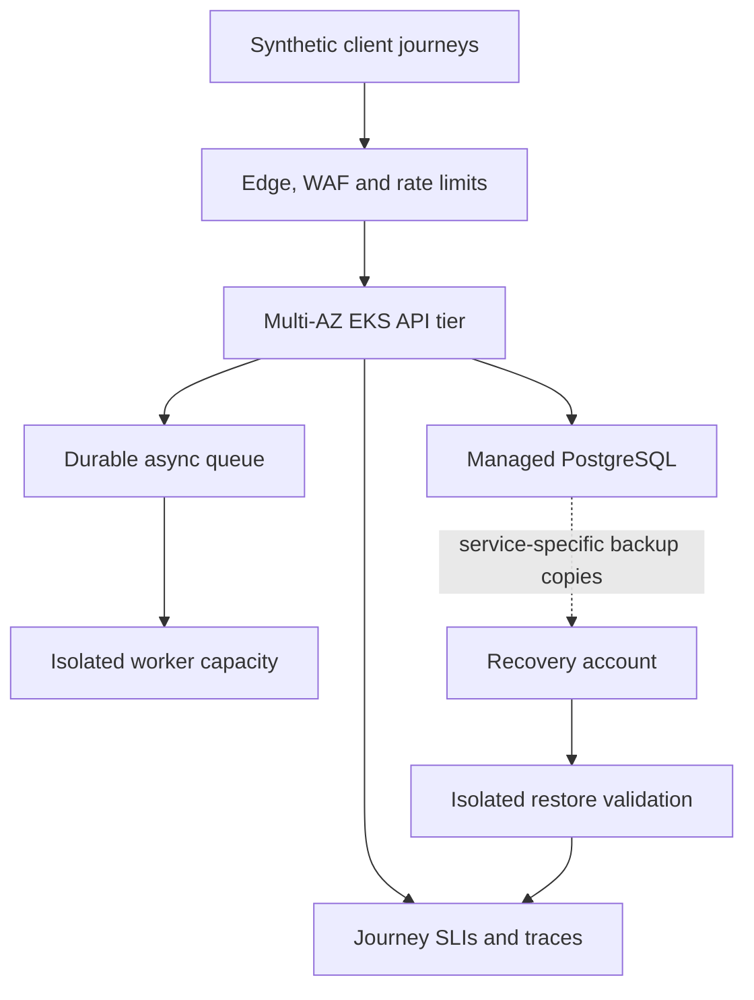

# Staff Infrastructure Engineering Lab

An independent, executable reliability case study for a hypothetical consumer application.
Designed to support discussion of the Coffee Meets Bagel Senior/Staff Infrastructure Engineer
role: architectural judgment, recovery, customer impact, secure delivery and sustainable cost.

**No CMB access, affiliation, endorsement, internal-system assessment or present-vulnerability
claims.** All workload data is generated locally. No employer configurations, real AWS account
identifiers, credentials or customer records are used. Nothing provisions cloud resources.

## Start here

Requires Python 3.11+ and optionally GNU Make; no packages, Docker, cloud account or network.

```bash
git clone https://github.com/prmaddi6233/staff-infrastructure-engineering-lab.git
cd staff-infrastructure-engineering-lab
# Before this PR merges, check out its feature branch.
git checkout feature/reliability-foundation
make verify
python3 -m reliability --scenario healthy
python3 -m reliability --scenario stale    # expected exit 1: promotion refused
python3 -m reliability --scenario corrupt  # expected exit 1: promotion refused
```

Without Make: `python3 -m unittest discover -s tests -v` followed by
`python3 scripts/check_repository.py`. Run from the repository root.
The demo writes only to a generated temporary directory and cleans up automatically.
It outputs a JSON decision; it never changes traffic or promotes a real service.

## Scope and implementation status

| Capability | Status | Evidence / boundary |
|---|---|---|
| SQLite backup, simulated primary loss, isolated target restore | Implemented on feature branch; locally tested | [Code](reliability/recovery.py), 15 tests |
| Checksum, schema/journey validation, local RTO/RPO-age gate | Implemented on feature branch; locally tested | [Tests](tests/test_recovery.py); failed candidate removed |
| CI, local-link and identifier regression checks | Implemented workflow | GitHub run status must be checked separately |
| AWS multi-account, EKS, recovery isolation | Proposed architecture | No AWS deployment, IAM proof or regional recovery test |
| Customer-journey SLOs and cloud RTO/RPO | Illustrative proposals | No production measurements or product-owner approval |
| Kubernetes fault drills, telemetry, signed backup provenance | Planned | [Outstanding backlog](ISSUE_BACKLOG.md) |

A passing demo is evidence of local recovery logic only. SQLite files in one process do
not model AWS administrative isolation, PostgreSQL consistency, encrypted backups,
network recovery, scale, DNS or identity availability. Integrity hashes require an
independently trusted expected digest. See [limitations and evidence](docs/validation.md).

## Architecture

**Proposed deployment**, not an existing CMB system:



The executable slice is narrower: temporary primary → SQLite backup → primary deletion →
new restore target → integrity and journey probe → promotion eligibility report.

## Review guide

- [Architecture overview and assumptions](docs/architecture.md)
- [AWS accounts, identity and network boundaries](docs/multi-account.md)
- [EKS availability, upgrades and overload](docs/eks-reliability.md)
- [Recovery objectives and game day](docs/disaster-recovery.md)
- [Customer-journey SLOs and observability](docs/observability.md)
- [Security and threat model](docs/security.md)
- [FinOps trade-offs and reuse](docs/finops.md)
- [Architecture decisions](docs/adr/README.md)
- [30/60/90-day roadmap](ROADMAP.md), [issue backlog](ISSUE_BACKLOG.md)
- [Role relevance and ethical boundaries](docs/cmb-case-study.md)

## Related projects: reuse rather than rebuild

Repository READMEs inspected on 2026-11-04; their claims/tests were not independently
revalidated here. This repository does not import or execute their infrastructure.

| Project | Existing scope | Boundary in this lab |
|---|---|---|
| [AWS platform control plane](https://github.com/prmaddi6233/aws-platform-control-plane) | Account lifecycle, policy and approval workflow | Link; do not rebuild vending |
| [AFT blueprint](https://github.com/prmaddi6233/aws-aft-account-factory-blueprint) | Control Tower/AFT customization patterns | Link; account boundaries are design only |
| [FinOps analytics pack](https://github.com/prmaddi6233/aws-finops-analytics-pack) | CUR/FOCUS queries and reporting | Link; no duplicate billing lake |
| [Cloud cost intelligence](https://github.com/prmaddi6233/cloud-cost-intelligence-platform) | Synthetic deterministic cost analytics | Link; use its methodology rather than new engine |
| [Cloud FinOps agent](https://github.com/prmaddi6233/cloud-finops-agent) | Recommendation and canary evidence | Link; no automated cloud mutation here |
| [EKS governance toolkit](https://github.com/prmaddi6233/eks-cost-governance-toolkit) | Namespace policy, quotas and allocation | Link; reliability drills are the distinct next slice |
| [EKS cost optimization](https://github.com/prmaddi6233/eks-cost-optimization) | Capacity and rightsizing patterns | Link; no duplicate Karpenter templates |
| [Portfolio](https://prmaddi6233.github.io) | Public project navigation | No site changes in this PR |

The initial uploaded ZIP was inspected and replaced on this branch by reviewable source.
Its obsolete publishing instructions and unverified historical incident references are not
carried forward. Original upload remains in Git history. Main is unchanged until review.

## PostgreSQL recovery drill

Run `bash scripts/test-postgres.sh` from the repository root as an unprivileged
Linux user with matching PostgreSQL server and client tools on PATH. Each case
starts a temporary cluster on a private Unix socket, restores a custom-format
dump into a fresh database, and removes the cluster. A separate local ledger
records acknowledged IDs. The missing-write case commits after the backup and
must refuse promotion even though the backup passes its checksum. Other cases
exercise corrupt bytes, an incompatible column, stale data and idempotent replay.
Reported elapsed time covers local verification and restore only. The ledger
shares the host and assumes an uninterrupted single writer.
