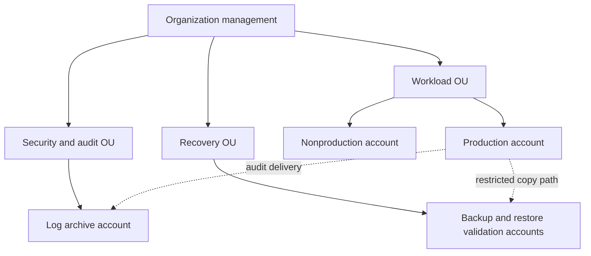

# AWS multi-account design

Status: proposed. Reuse existing account-vending and control-plane projects linked in the README.
No account identifiers or deployable IAM policies are required for this case study.

Management has no workloads. Separate security audit from log retention and production from
nonproduction. Recovery operators use separately controlled roles and credentials; workload
administrators cannot assume them or change recovery retention. This is a threat boundary
to validate, not a guarantee against organization-management compromise.

Federate workforce access with MFA, short-lived role sessions and permission sets scoped by
job function. Emergency access needs independent authentication, dual control where practical,
credential rotation and an exercised audit trail. CI deploy identity, if added later, must
bind OIDC subject and audience to a reviewed environment; no cloud identity is used by current CI.
SCPs constrain allowed actions but grant no permissions. Rehearse exceptions in nonproduction
before enforcing region restrictions, encryption requirements or deletion restrictions.

Network intake must allocate a nonoverlapping CIDR in IPAM before VPC creation, associate
ownership/environment metadata and validate DNS, endpoint and egress routes. TGW RAM sharing,
attachment acceptance, route-table association/propagation and return routing are separate
steps. Do not assume sharing creates connectivity. Prefer account-local service endpoints
when a centralized hub adds avoidable cost or failure coupling. No IPAM pools are implemented.

Infrastructure states should be split by account and lifecycle with encrypted versioned remote
state, locking and narrowly scoped writers. Independent recovery needs copies of configuration,
artifact digests and key-access instructions outside the failed workload boundary. State files
may contain secrets and must never be committed to this public repository.

Verification proposal: with a workload test role, attempt recovery-point deletion, key-policy
change and recovery-role assumption; each must be denied. Independently restore and audit the
attempts. Test permitted copy behavior as well as denial so an overrestrictive guardrail does
not silently stop backup creation.
